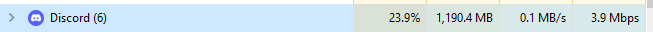
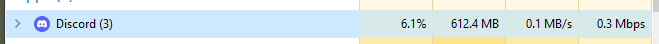

# Relay

Relay is a native launcher for the **official Discord desktop app** on Windows and Linux. It lets you try different JavaScript memory settings and measure Discord’s private RAM. It exits after launch, keeps your normal Discord shortcut intact, and works **with or without Vencord**.

Relay is not a Discord replacement. A smaller launcher does not mean a smaller Discord session: the client, your activity, and any plugins determine most of its memory use.

## Run on Linux

Download the [**x86-64 Linux AppImage**](https://github.com/waggynotfound/discord-native-lite/releases/download/v2.1.0/Relay-2.1.0-linux-x86_64.AppImage). From the download folder:

```sh
chmod +x Relay-2.1.0-linux-x86_64.AppImage
./Relay-2.1.0-linux-x86_64.AppImage
```

Use a native Discord installation and an X11 or XWayland desktop. There is also a terminal mode. No root or installer required. See the [Linux guide](linux/README.md) for custom tarball paths, the FUSE fallback, data location and known limits. This AppImage is not for ARM, Flatpak, or Snap installations of Discord.

## Install on Windows

Download [**Relay-2.1.0-windows-x64-setup.exe**](https://github.com/waggynotfound/discord-native-lite/releases/download/v2.1.0/Relay-2.1.0-windows-x64-setup.exe) from the [2.1.0 release](https://github.com/waggynotfound/discord-native-lite/releases/tag/v2.1.0). The setup installs for the current user, adds a Start menu shortcut, and offers an optional desktop shortcut. Open **Relay** from Start. To remove it, use Windows **Settings → Apps → Relay → Uninstall**. Uninstalling Relay leaves Discord, Vencord, and your saved readings intact.

Prefer not to install? Extract `Relay-2.1.0-windows-x64-portable.zip` and run `Relay.exe`. Both packages are unsigned. The release includes `SHA256SUMS.txt`; compare its entry with `Get-FileHash -Algorithm SHA256 <downloaded-file>` to verify your download. Release downloads are public.

## Build from source

Use Windows 10 or 11 (x64) and a current stable [Rust toolchain](https://www.rust-lang.org/tools/install). With the standard MSVC toolchain, install the Visual Studio C++ build tools and Windows SDK when prompted. From the repository root:

```powershell
cargo build --release --locked
.\target\release\Relay.exe
```

Only `Relay.exe` is needed to run the launcher. No .NET runtime, browser extension, administrator privileges, or installation step is required. The optional `build.ps1` wrapper also copies the release executable to the repository root.

## Choose a profile

Select an installed **Stable**, **Canary**, or **PTB** channel. Finish any call, then right-click Discord’s notification-area icon and choose **Quit Discord**. Closing the main window can leave Discord running. Select a profile in Relay and click **Start Discord**. Relay will not terminate an existing client.

| Profile | What changes |
| --- | --- |
| **Stock** | No flags from Relay. Use this for a baseline. Stock does **not** turn off Vencord. |
| **Balanced** | `--optimize-for-size` asks V8 to favor memory size over execution speed. |
| **Strong saver** (preselected) | Adds `--memory-saver-mode` and `--heap-growing-percent=15`, asking V8 to use less heap headroom when its growth-factor policy applies. |

Relay passes the V8 flags together through Electron’s `--js-flags` switch. These are **not RAM caps**. More frequent garbage collection can cost CPU or make scrolling less smooth, and the flags may not help your workload. Updates can change how Discord handles them. To revert, quit Discord and use **Stock** or your normal shortcut.

## Measure the difference

1. Use the same channel, window state, plugins, and activity for each run. Give each fresh launch the same warm-up time; do not compare a long-running call to a newly opened text channel.
2. Reopen Relay, select **Compare RAM**, and click **Record 30 seconds**. Repeat with the other profile. For a closer comparison, repeat in the opposite order.
3. Compare the saved medians. **Private RAM** counts resident private pages across the selected client’s processes. **Renderer RAM** is part of that total, not extra. **Committed memory** includes allocations that need not be resident.

Each recording uses seven complete samples roughly five seconds apart. Relay verifies the profile from the running main and renderer processes. It discards incomplete recordings or recordings in which the session changes. Only readings from the same Discord channel and build are compared.

### Example: two Task Manager snapshots

**Ordinary Discord — 1,190.4 MB, 6 processes**



**Discord launched with Relay — 612.4 MB, 3 processes**



The second snapshot shows **578.0 MB less memory (48.6%)**. These are user-provided, single-point readings of **Discord**, not the launcher's RAM or a controlled benchmark. Process counts, CPU load, and network activity differed. The screenshots alone cannot attribute the difference to Relay or Vencord. Use the procedure above to test your own workload.

## Local data and compatibility

Relay makes no network requests. It reads local installation paths, a small Vencord entry-point marker, and Windows process metadata. It does not read chats, tokens, or plugin settings. **Vencord detected** identifies a loader marker, not a guarantee that every plugin works.

Recordings are saved under `%LOCALAPPDATA%\RelayLauncher\readings` as timestamps and aggregate byte counts. A completed recording replaces only its channel/build/profile slot. Older `Saver.tsv` readings appear as **Balanced**. Remove that directory if you want to clear your readings.

## Development and license

See [CONTRIBUTING.md](CONTRIBUTING.md) for the source layout, tests, and release checks. Relay is licensed under the [GNU General Public License, version 3 only](LICENSE) (`GPL-3.0-only`). Discord and Vencord are separate projects and are not distributed with Relay. Relay is not affiliated with either project.
